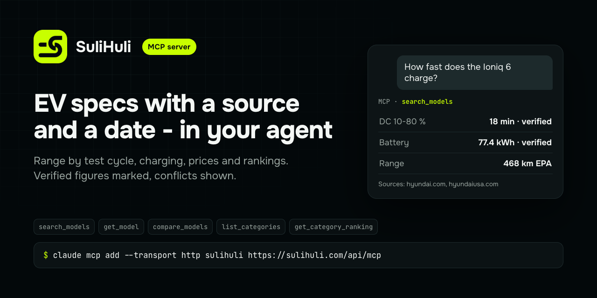

# SuliHuli MCP server

Electric-vehicle specs, prices, rankings and comparisons for AI agents - every figure with its source link and the
date it was read. Figures confirmed by a second independent source or a regulator are marked **verified**.

- **Server:** `https://sulihuli.com/api/mcp` - remote, Streamable HTTP, read-only, no sign-in, no key.
- **Limit:** 60 requests per minute per address.
- **MCP Registry name:** `com.sulihuli/catalog`.

This repository holds the connection files, the plugin and the skill. The server runs at sulihuli.com.

## Tools

| Tool | What it does |
| --- | --- |
| `search_models` | Find models by brand or name, ranked by a use-case preset; filter by minimum range. |
| `get_model` | One model: range per test cycle, charging, battery, prices per market, sources, photos with credits. |
| `compare_models` | Two to four models side by side with a "which to pick" verdict. |
| `list_categories` | The "best EV for ..." rankings and their public criterion. |
| `get_category_ranking` | One ranking with its models. |

## Connect

| Client | How |
| --- | --- |
| Claude, Claude Desktop | Settings - Connectors - Add custom connector - `https://sulihuli.com/api/mcp` |
| Claude Code | `claude mcp add --transport http sulihuli https://sulihuli.com/api/mcp` |
| Claude Code, plugin | `/plugin install sulihuli --marketplace sulihuli/mcp` |
| ChatGPT | Settings - Apps - developer mode - Create - URL `https://sulihuli.com/api/mcp`, no authentication |
| Cursor | [`.mcp.json`](.mcp.json) in your project or `~/.cursor/mcp.json` |
| VS Code | `code --add-mcp '{"name":"sulihuli","type":"http","url":"https://sulihuli.com/api/mcp"}'` |
| Codex | `codex mcp add sulihuli --url https://sulihuli.com/api/mcp` |
| Gemini CLI | `gemini extensions install https://github.com/sulihuli/mcp` |

No MCP client? The same data is an HTTP API: `https://sulihuli.com/api/v1/` (index: https://sulihuli.com/llms.txt).

## Example questions

- What is the WLTP range of the Hyundai Ioniq 6, and where does the figure come from?
- Compare the Tesla Model 3 and the Hyundai Ioniq 6 on range, charging and price.
- What are the best long-range electric cars right now?

## Terms

Data and photos: https://sulihuli.com/terms. Privacy: https://sulihuli.com/privacy. Contact: hello@sulihuli.com.
The files in this repository are MIT-licensed; the data the service returns is not covered by that licence.
